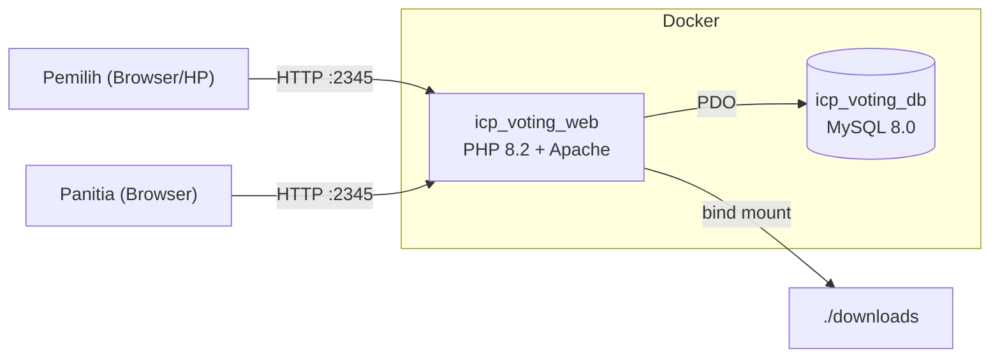
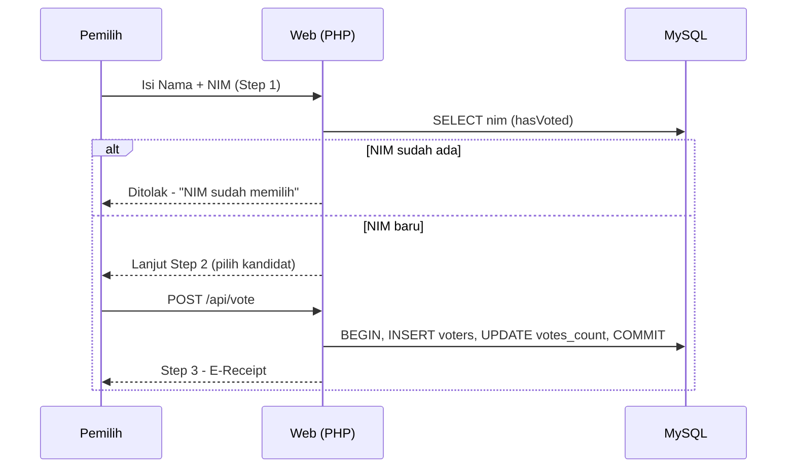
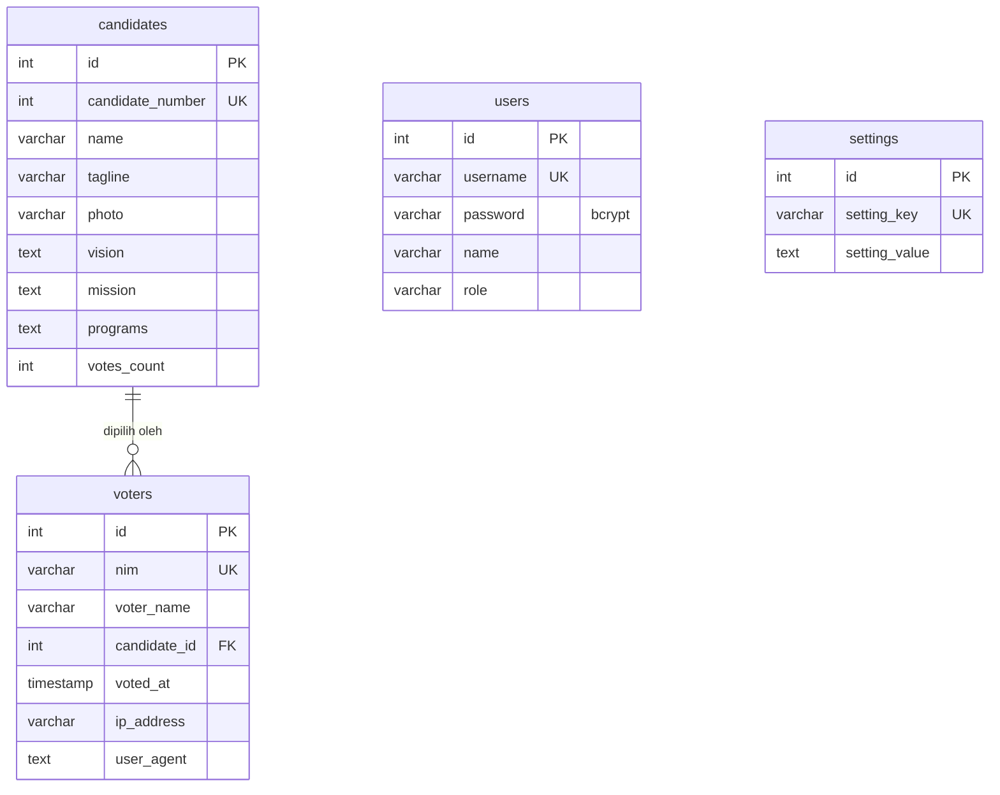

# Dokumentasi Teknis — Web Voting Pemilihan Ketua ICP 2026–2027

## Daftar Isi
1. [Arsitektur](#arsitektur)
2. [Alur Voting](#alur-voting)
3. [Skema Database](#skema-database)
4. [Routing & Endpoint](#routing--endpoint)
5. [Realtime Quick Count](#realtime-quick-count)
6. [Panel Admin](#panel-admin)
7. [Export PDF & Excel](#export-pdf--excel)
8. [Konfigurasi](#konfigurasi)
9. [Mengganti Password Admin](#mengganti-password-admin)
10. [Operasional & Perintah Berguna](#operasional--perintah-berguna)
11. [Troubleshooting](#troubleshooting)
12. [Checklist Sebelum Hari Pemilihan](#checklist-sebelum-hari-pemilihan)

---

## Arsitektur



- **Pola MVC sederhana** tanpa framework: `public/index.php` sebagai front controller, autoloader PSR-4 untuk namespace `App\` → `src/`.
- **Clean URL**: `.htaccess` mengarahkan semua request non-file ke `index.php`.
- **Aset lokal**: Tailwind (runtime), Chart.js, FontAwesome, Confetti disajikan dari `public/assets/` sehingga tidak bergantung CDN (penting saat diakses via IP LAN).

---

## Alur Voting



Validasi NIM dilakukan **tiga lapis**: cek awal (`/api/check-voter`), cek ulang saat submit (`/api/vote`), dan constraint `UNIQUE` di MySQL (mencegah race condition).

---

## Skema Database



File inisialisasi: `mysql-init/01-init.sql` (hanya dijalankan saat volume MySQL masih kosong).

---

## Routing & Endpoint

| Method | Path | Auth | Keterangan |
|---|---|---|---|
| GET | `/` | – | Redirect `/voting` |
| GET | `/voting` | – | Bilik suara |
| POST | `/api/check-voter` | – | Body form: `nama`, `nim` → `{allowed, message}` |
| POST | `/api/vote` | – | Body form: `nama`, `nim`, `candidate_id` → `{success, message}` |
| GET/POST | `/login` | – | Form & proses login |
| GET | `/logout` | – | Logout |
| GET | `/dashboard` | Admin | Redirect `/admin/dashboard` |
| GET | `/admin/dashboard` | Admin | Dashboard admin |
| GET | `/live-count` | Admin | Layar quick count (fullscreen) |
| GET | `/api/results` | Admin | JSON hasil terkini |
| GET | `/api/stream` | Admin | SSE event `vote_update` |
| GET | `/admin/candidates` | Admin | Daftar calon |
| GET/POST | `/admin/candidates/create` | Admin | Tambah calon |
| GET/POST | `/admin/candidates/edit?id=` | Admin | Edit calon |
| POST | `/admin/candidates/delete` | Admin | Hapus calon (`id`) |
| GET | `/admin/voters` | Admin | Daftar pemilih |
| POST | `/admin/voters/delete` | Admin | Hapus 1 pemilih (`id`), tally dikurangi |
| POST | `/admin/voters/clear` | Admin | Kosongkan semua suara |
| POST | `/admin/reset` | Admin | Reset pemilihan |
| GET | `/export/pdf` | Admin | Unduh PDF |
| GET | `/export/xlsx` | Admin | Unduh XLSX |

Contoh uji via curl:

```bash
curl -X POST http://localhost:2345/api/check-voter -d "nama=Budi&nim=20260001"
curl -X POST http://localhost:2345/api/vote -d "nama=Budi&nim=20260001&candidate_id=1"
```

---

## Realtime Quick Count

- `/api/stream` mengirim event SSE `vote_update` setiap ada perubahan data (dicek tiap ~1 detik, koneksi diperbarui tiap 30 detik, heartbeat untuk menjaga koneksi).
- Sebagai cadangan, halaman juga melakukan polling `/api/results` setiap 3 detik.
- Payload: `total_votes`, `candidates[]` (votes_count, percentage), `timeline_stats[]` (suara per jam), `recent_voters[]`.
- Tombol **Full Screen** memakai Fullscreen API browser (bisa juga F11).

---

## Panel Admin

Setelah login, semua halaman admin menggunakan layout dengan **sidebar** (`public/views/layout/admin_header.php` & `admin_footer.php`). Di layar kecil, sidebar dibuka lewat tombol ☰.

- **Kelola Calon**: nomor urut, nama, tagline, foto, visi, misi, program kerja. Langsung tampil di `/voting`.
- **Data Pemilih**: pencarian, hapus per baris, kosongkan semua.
- **Layout kandidat dinamis**: 1 calon → 1 kolom, 2 → 2 kolom, 3 → 3 kolom, 4 → 4 kolom, >4 → grid responsif.

---

## Export PDF & Excel

- PDF dibuat dengan FPDF (`src/Utils/PdfReport.php`), Excel dengan writer XLSX ringan tanpa dependency (`src/Utils/SimpleXLSXWriter.php`).
- Isi: rekap perolehan per kandidat + daftar pemilih (No, NIM, Nama, Pilihan, Waktu).
- File diunduh browser **dan** disalin ke `./downloads/` di host.

---

## Konfigurasi

Diatur di `docker-compose.yml`:

| Variabel | Default | Keterangan |
|---|---|---|
| port web | `2345:80` | Ubah sisi kiri untuk mengganti port host |
| `DB_HOST` | `db` | Nama service MySQL |
| `DB_NAME` | `icp_voting` | |
| `DB_USER` / `DB_PASS` | `icp_user` / `icp_password` | Samakan dengan `MYSQL_USER` / `MYSQL_PASSWORD` |
| `MYSQL_ROOT_PASSWORD` | `icp_root_password` | |

> Untuk produksi, **ganti semua password** di atas sebelum menjalankan pertama kali.

---

## Mengganti Password Admin

```bash
# buat hash baru
docker exec icp_voting_web php -r "echo password_hash('PasswordBaru123', PASSWORD_BCRYPT), PHP_EOL;"

# simpan ke database
docker exec -it icp_voting_db mysql -uicp_user -picp_password icp_voting \
  -e "UPDATE users SET password='<HASH_DI_ATAS>' WHERE username='icp';"
```

---

## Operasional & Perintah Berguna

```bash
docker compose ps                 # status container
docker compose logs -f web        # log web
docker compose up -d --build      # rebuild setelah ubah kode
docker compose down -v            # HAPUS semua data & mulai dari nol

# backup database
docker exec icp_voting_db mysqldump -uicp_user -picp_password icp_voting > backup.sql
# restore
docker exec -i icp_voting_db mysql -uicp_user -picp_password icp_voting < backup.sql
```

---

## Troubleshooting

| Masalah | Solusi |
|---|---|
| Port 2345 sudah dipakai | Ubah mapping port di `docker-compose.yml` |
| Tampilan berantakan dari IP lain | Pastikan folder `public/assets/` ikut ter-deploy; hard refresh (Ctrl+F5) |
| Tidak bisa diakses dari HP/PC lain | Izinkan port 2345 di Windows Firewall; pastikan satu jaringan |
| Skema DB lama (masih ada kolom angkatan) | `docker compose down -v` lalu `./start.sh` (data akan terhapus) |
| Quick count tidak update | Cek indikator status; polling fallback tetap berjalan tiap 3 detik |
| Error koneksi DB saat awal start | Tunggu MySQL healthy (± 15–30 detik) lalu refresh |

---

## Checklist Sebelum Hari Pemilihan

- [ ] Ganti password admin & password database
- [ ] Input semua calon beserta visi-misi dan foto
- [ ] Uji coba voting, lalu **Kosongkan Semua Suara**
- [ ] Buka port 2345 di firewall server
- [ ] Siapkan layar proyektor di `/live-count` → **Full Screen**
- [ ] Backup database setelah pemilihan selesai
